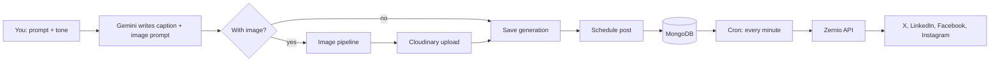
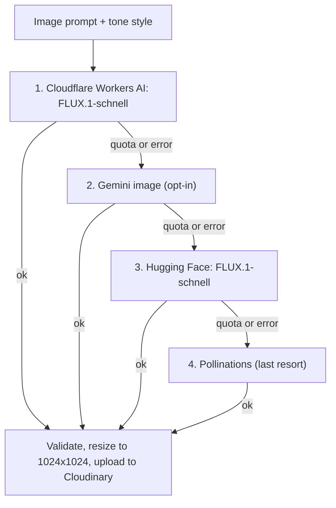

<div align="center">
# 🚀 QueueUp
 
**Write once. Schedule anywhere. Let AI do the heavy lifting.**
 
Compose posts (or have AI write them *and* design the picture), queue them up, and publish to
X/Twitter, LinkedIn, Facebook and Instagram, all from one place.
 


 
</div>
---
 
## ✨ What it does
 
| | Feature | Details |
|---|---|---|
| 🧠 | **AI Composer** | Describe a post in plain English, pick a tone (*Professional, Creative, Funny, Minimalist, Excited*) and get a caption with hashtags. Gemini writes the copy. |
| 🎨 | **AI images** | Optionally generate a matching 1024×1024 image. A multi-provider pipeline picks the best available free option and falls back automatically. |
| 🗓️ | **Scheduler** | Pick a date and time, choose platforms, or save as a draft. A cron job publishes due posts every minute. |
| 📣 | **Multi-platform publishing** | X/Twitter, LinkedIn (profile and page), Facebook (profile and page) and Instagram (personal and business) through [Zernio](https://zernio.com). |
| 🛡️ | **Guard rails** | Per-platform character limits, Instagram media requirement, URL and platform validation. Bad input is rejected before it reaches a queue. |
| 🕘 | **History** | Your last 50 generations are saved so you can reuse a caption or image and schedule it later. |
 
---
 
## 🧩 How it fits together
 

 
### 🖼️ The image pipeline
 
Free image tiers come and go, so QueueUp never depends on just one. Providers are tried in order
until one returns a valid image:
 

 
What keeps it reliable:
 
- **Smart prompts.** Each tone maps to its own visual style, with photography direction and a
  strict *no text, no logos* rule appended to every prompt.
- **Validation.** Every image must decode and meet a minimum size, so error pages never become posts.
- **Cooldowns.** A provider that hits its quota is skipped for an hour; one with a bad model name
  is skipped for 24 hours.
- **Clear logs.** Each generation prints which provider won (`[image] generated with cloudflare`)
  and why others failed.
- **Honest API responses.** The generate endpoint returns `imageGenerationFailed`,
  `imageProvider` and `imageError`, so the UI can tell the user exactly what happened.
---
 
## 🛠️ Tech stack
 
- **Backend:** Express 5, TypeScript, MongoDB (Mongoose), `node-cron`-style scheduler service, `sharp`
- **Frontend:** React 19, Vite, Tailwind CSS 4
- **AI:** Google Gemini (captions), Cloudflare Workers AI / Hugging Face / Gemini / Pollinations (images)
- **Media:** Cloudinary
- **Publishing:** Zernio
---
 
## ⚡ Quick start
 
Requires **Node.js 22+** and a MongoDB instance (local or Atlas).
 
```bash
# 1. Backend
cd backend
cp .env.example .env      # fill in the values (see below)
npm install
npm run server            # dev (nodemon + tsx), or `npm start`
 
# 2. Frontend (second terminal)
cd frontend
cp .env.example .env
npm install
npm run dev
```
 
Then open **http://localhost:5173**. The API runs on **http://localhost:3000**.
 
> 🔁 `.env` is only read at startup. After changing it, stop the backend (`Ctrl+C`) and start it again.
 
---
 
## 🔑 Environment variables (`backend/.env`)
 
`MONGODB_URL` and `JWT_SECRET` are **required**; the server refuses to start without them. Every
other key is optional at boot, and a feature that needs a missing key reports a clear error.
 
```env
# --- Core (required) ---
MONGODB_URL="mongodb+srv://<user>:<password>@<cluster>/<db>"
JWT_SECRET="a-long-random-string"
 
# --- Publishing ---
ZERNIO_API_KEY="sk_..."
 
# --- Captions (and optional Gemini images) ---
GEMINI_API_KEY="..."
# GEMINI_MODEL="gemini-2.5-flash"
# GEMINI_IMAGE_ENABLED="true"          # opt-in: needs billing on your Google project
# GEMINI_IMAGE_MODEL="gemini-2.5-flash-image"
 
# --- Image storage ---
CLOUDINARY_CLOUD_NAME="..."
CLOUDINARY_API_KEY="..."
CLOUDINARY_API_SECRET="..."
 
# --- AI images: recommended free provider ---
CLOUDFLARE_ACCOUNT_ID="..."
CLOUDFLARE_API_TOKEN="..."
# CLOUDFLARE_IMAGE_MODEL="@cf/black-forest-labs/flux-1-schnell"
 
# --- AI images: optional extra providers ---
# HF_TOKEN="hf_..."                    # HUGGINGFACE_API_KEY also works
# HF_IMAGE_MODEL="black-forest-labs/FLUX.1-schnell"
# POLLINATIONS_DISABLED="true"         # prefer a clear error over a low-quality fallback
# POLLINATIONS_TOKEN="..."
```
 
### Getting the free image keys
 
**Cloudflare Workers AI (recommended).** The free allowance renews daily and needs no credit card.
 
1. Sign up at [dash.cloudflare.com](https://dash.cloudflare.com).
2. Your **Account ID** is the 32-character string in the dashboard URL
   (`dash.cloudflare.com/<ACCOUNT_ID>/home`).
3. Go to **My Profile → API Tokens → Create Token**, use the **Workers AI** template, and copy the
   token right away. It is only shown once.
**Hugging Face (optional).** Create a token at
[huggingface.co/settings/tokens](https://huggingface.co/settings/tokens) with the
*Make calls to Inference Providers* permission.
 
> Free-tier limits change over time, so check each provider's dashboard for your current allowance.
 
---
 
## 🗂️ Project structure
 
```
QueueUp/
├── backend/
│   ├── config/            # Cloudinary and other service setup
│   ├── controllers/       # account, activity, auth, post, socialAuth
│   ├── middlewares/       # auth (JWT)
│   ├── models/            # Account, Activity, Generation, Post, User, platforms
│   ├── routes/            # one router per controller
│   ├── services/          # schedulerService (the publish-due-posts cron job)
│   └── server.ts
└── frontend/              # React + Vite app (AI Composer, scheduler, accounts)
```
 
---
 
## ✅ Checks
 
```bash
cd backend  && npm run typecheck
cd frontend && npm run lint && npm run build
```
 
---
 
## 🩺 Troubleshooting
 
| Symptom | Likely cause and fix |
|---|---|
| Image looks blurry or off-topic | The fallback provider was used. Check the terminal for `[image] generated with ...` and configure Cloudflare. |
| `cloudflare skipped (not configured)` | `CLOUDFLARE_ACCOUNT_ID` or `CLOUDFLARE_API_TOKEN` is missing, or you did not restart the backend after editing `.env`. |
| `cloudflare failed ... 401 / 403` | Token is wrong or lacks Workers AI permission. Recreate it from the *Workers AI* template. |
| `cloudflare failed ... 404` | Account ID was copied incorrectly. |
| `quota exceeded, skipping it for 1 hour` | Expected on free tiers. The next provider takes over automatically. |
| `huggingface failed ... 401` | Invalid Hugging Face token. Create a new one. |
| `Instagram requires an image or video` | Attach media or generate an image before scheduling to Instagram. |
| `Content is N characters; the twitter limit is 280` | Shorten the caption or deselect that platform. |
 
---
 
## 🔐 Security notes
 
- Never commit `.env`. Confirm it is listed in `.gitignore`.
- If a key or secret ever appears in a screenshot, log or commit, **rotate it** right away.
- Use a long, random `JWT_SECRET` in production.
---
 
## 🗺️ Roadmap ideas
 
- [ ] Show the image provider and any image error in the AI Composer UI
- [ ] Regenerate-image button with a different seed or style
- [ ] Post analytics pulled back from each platform
- [ ] Bulk scheduling from a CSV
- [ ] Best-time-to-post suggestions
---
 
<div align="center">
Built with ☕ and a lot of fallback logic.
 
</div>
 